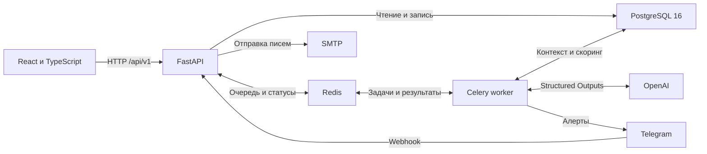
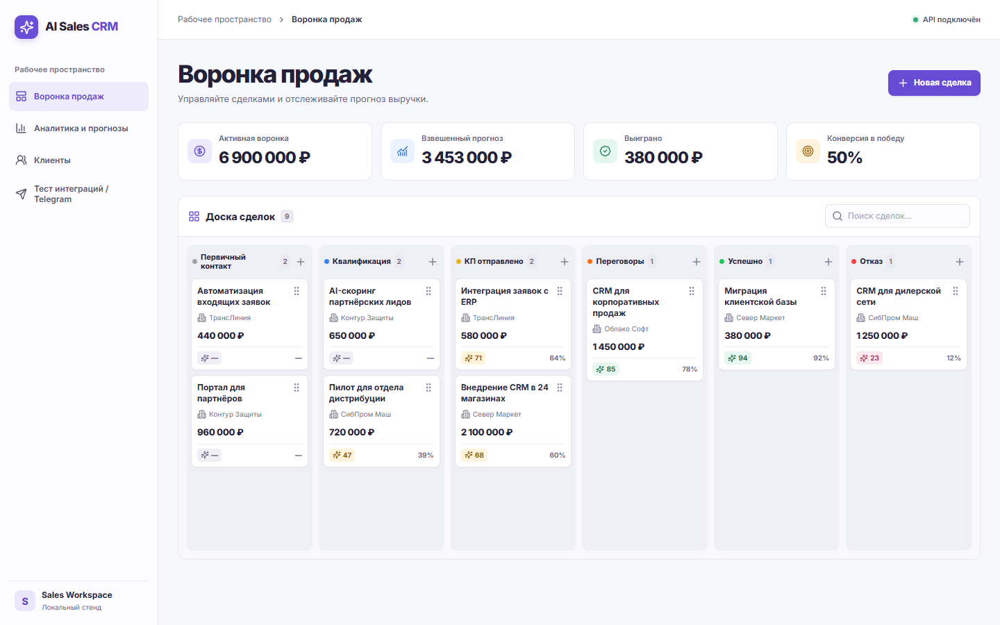
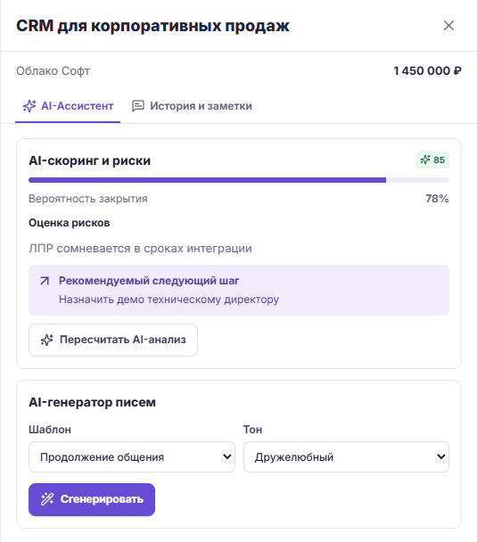
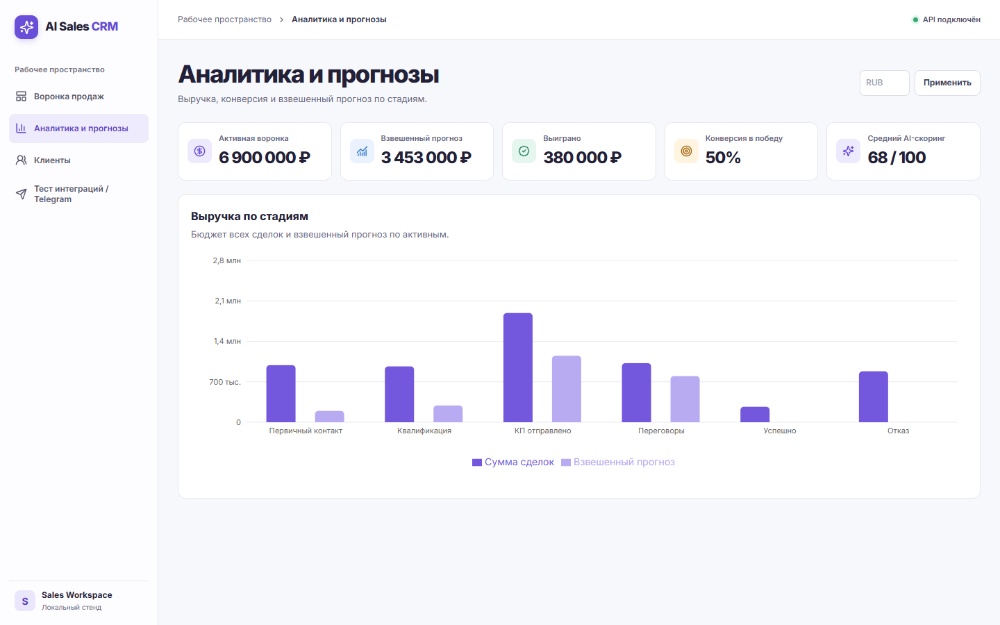
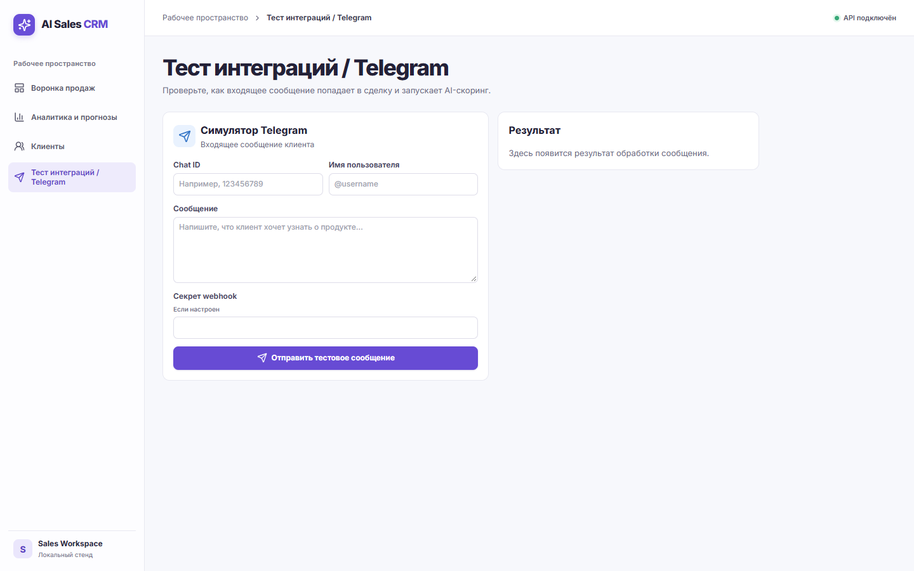

# AI Sales CRM


AI Sales CRM помогает B2B-команде понять, какие сделки требуют внимания, что обсудить с клиентом дальше и какую выручку можно ожидать. Менеджер работает с воронкой и коммуникациями в одном интерфейсе, а руководитель сравнивает бюджеты с прогнозом, взвешенным по вероятности закрытия.

- **Kanban** с перетаскиванием карточек, оптимистичным обновлением и откатом при ошибке.
- **AI-анализ сделки** с оценкой от 0 до 100, вероятностью закрытия, рисками и следующим действием. Celery обрабатывает задачи в фоне.
- **Черновики писем** для четырёх сценариев и трёх тональностей. Менеджер редактирует текст перед отправкой через SMTP.
- **История коммуникаций** с письмами, звонками, заметками и Telegram. Webhook связывает входящее сообщение со сделкой, запускает скоринг и защищает стандартные Update от повторной записи.
- **Аналитика** с активным бюджетом, выручкой выигранных сделок, конверсией и взвешенным прогнозом. При нескольких валютах отчёт строится по выбранной валюте.

[Техническое задание](docs/Technical_Specification.docx) описывает требования, целевые KPI, критерии приёмки и условия промышленного внедрения.

## Архитектура



## Быстрый старт

Понадобится Docker с Compose v2. Выполните команды из корня проекта.

1. Создайте локальный файл настроек. Если `backend/.env` уже существует, используйте его.

   ```powershell
   Copy-Item backend/.env.example backend/.env
   ```

2. Для нового стенда задайте пароль PostgreSQL в `backend/.env`. Пустой `OPENAI_API_KEY` или значение `mock` включает локальную генерацию. Пустой `SMTP_HOST` включает демо-отправку с записью в журнал.

3. Соберите и запустите стек, затем загрузите демоданные.

   ```powershell
   docker compose --env-file backend/.env up --build -d --wait
   docker compose --env-file backend/.env exec -T api python -m app.seed
   ```

   Указывайте `--env-file backend/.env` в командах Compose. Он подставляет переменные PostgreSQL из файла, расположенного в папке `backend`.

4. Откройте [CRM](http://127.0.0.1:5173/), [Swagger UI](http://127.0.0.1:8000/docs) или [health-check](http://127.0.0.1:8000/api/v1/health).

Для демонстрации откройте сделку на доске, запустите AI-анализ и сгенерируйте черновик. Затем отправьте тестовое входящее сообщение из раздела Telegram и перейдите к созданной сделке. Если сервер настроен с `TELEGRAM_WEBHOOK_SECRET`, введите его в поле секрета симулятора.

## Демонстрация интерфейса

| Экран | Плейсхолдер |
| --- | --- |
| Kanban и показатели воронки | `docs/screenshots/kanban.png` |
| Карточка сделки и AI-ассистент | `docs/screenshots/ai-drawer.png` |
| Аналитика и прогноз выручки | `docs/screenshots/analytics.png` |
| Симулятор Telegram | `docs/screenshots/telegram-sim.png` |

<!--




-->

## Генерация технического задания

```powershell
python -m pip install python-docx
python backend/scripts/generate_tz.py
```

Генератор сохраняет Word-файл в `docs/Technical_Specification.docx`. Для публикации используйте синтетические данные и шаблоны `.env.example`. Локальные `.env` исключены из Git.
