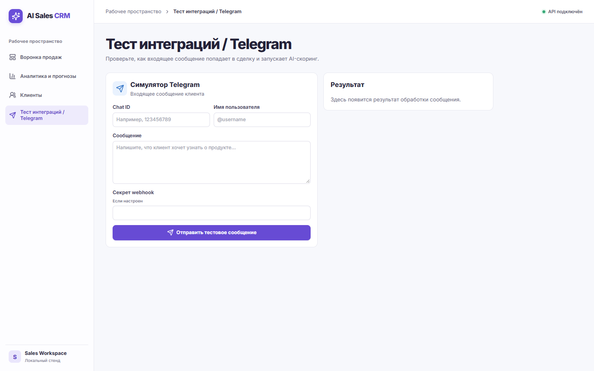
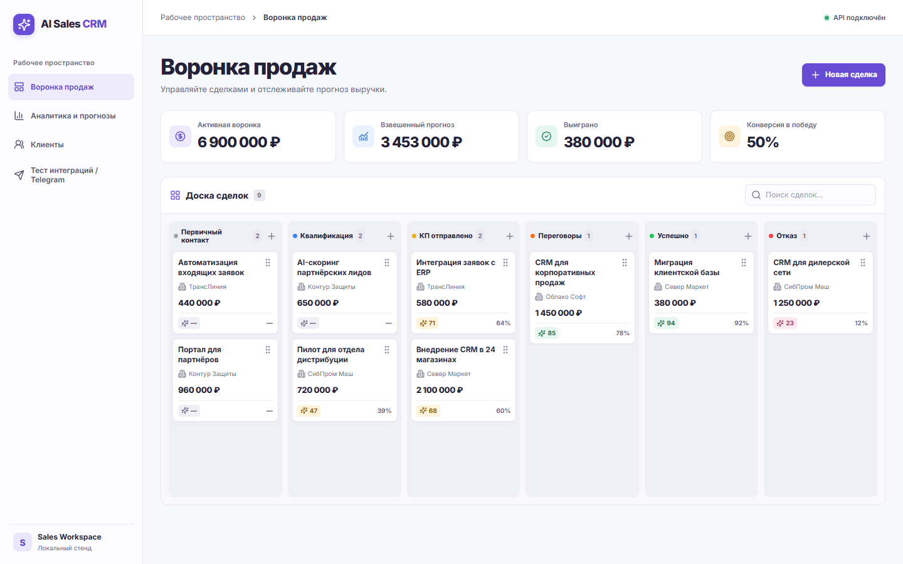
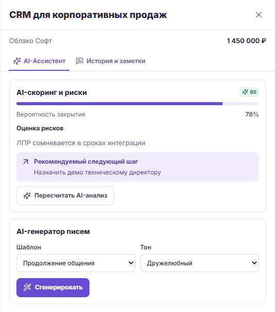
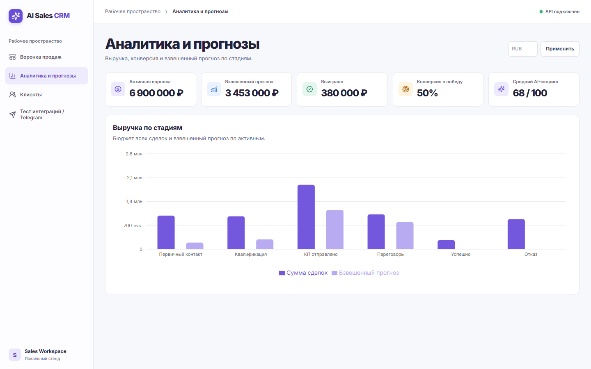

# Как AI Sales CRM ускоряет работу с B2B сделками

AI Sales CRM берёт на себя три повторяющихся действия: фиксирует входящий лид, готовит персонализированный черновик письма и пересчитывает прогноз при изменении сделки. Менеджер получает конкретный следующий шаг, а руководитель видит, из каких сделок складывается ожидаемая выручка. Это портфельный проект с работающим демостендом. Ускорение закрытия и окупаемость — цели для пилота.

## Проблема отдела продаж

**Рутина.** Для пилота закладываем гипотезу, что у отдельных команд до 40% недели может уходить на ведение карточек и подготовку повторных писем. Этот показатель нужно замерить по рабочим журналам. Для рыночного контекста Salesforce сообщает, что 60% недели приходится на задачи вне непосредственных продаж. В эту категорию входят и другие виды работы. [Salesforce State of Sales, 7-е издание](https://www.salesforce.com/blog/small-business/state-of-sales-takeaways-for-smbs/).

**Непрозрачный прогноз.** Формулировка «клиент вроде готов» по-разному понимается менеджером и РОПом. Если сделки попадают в план по полному бюджету, задержка крупного контракта способна застать команду врасплох. Даже взвешенный прогноз CRM нужно дополнять графиком платежей для управления ликвидностью.

**Потерянные лиды.** Сообщение в Telegram может остаться в переписке без владельца и следующего действия. Пока сотрудник вручную заводит карточку, команда не видит, что клиент уже обратился.

## Как устроено решение

React показывает воронку Kanban и карточку сделки. FastAPI валидирует запросы и сохраняет бизнес-данные в PostgreSQL. Celery получает фоновые задачи через Redis, загружает контекст сделки, обращается к OpenAI и записывает оценку обратно. Интерфейс проверяет статус задачи отдельно, поэтому ожидание модели не удерживает запрос на запись. Код скоринга проверяет, что сделка и её последние коммуникации не изменились во время расчёта.

**Structured Outputs** задаёт контракт ответа: скоринг 0–100, вероятность от 0 до 1, риски и следующее действие. Для успешно сформированного ответа SDK использует JSON Schema, а Pydantic проверяет результат в приложении. Отказ модели и незавершённый ответ обрабатываются как сбой задачи. Проверка структуры защищает интерфейс от некорректного формата, а достоверность выводов зависит от контекста и требует проверки менеджером. [OpenAI Structured Outputs](https://developers.openai.com/api/docs/guides/structured-outputs?api-mode=chat).

Пустой ключ или значение `mock` включает локальный режим с синтетическими результатами. Он позволяет показать весь процесс и проверить очередь без расходов на модель. Сбои при настроенном действующем ключе остаются видимыми в статусе задачи.

## Сценарии работы с лидами

### 1 Захват лида из Telegram

> Входящее сообщение → карточка и журнал → оценка → уведомление менеджеру.

Webhook находит клиента по чату, привязывает сообщение к активной сделке или создаёт новую и ставит скоринг в очередь. Повтор стандартного Update с тем же идентификатором не создаёт вторую запись. Когда оценка впервые достигает 80 баллов или снова пересекает порог снизу, настроенный менеджер получает алерт после расчёта.



### 2 Умная воронка продаж

> Менеджер переносит карточку → CRM сохраняет стадию → AI пересчитывает открытые сделки.

Карточка сразу меняет колонку и возвращается назад при ошибке API. Переход на новую открытую стадию запускает пересчёт Win Probability. AI может выделить сомнения ЛПР или сдвиг сроков и предложить Next Best Action, например согласовать дату демонстрации с владельцем бюджета. Финальные стадии фиксируют закрытие сделки.



## Сценарии коммуникаций и аналитики

### 3 Контекстное письмо из карточки

> Выбрать шаблон и тон → получить черновик → проверить и отправить.

В журнале доступна история сделки. Модель получает данные о клиенте и до восьми последних записей, включая звонки, заметки и сообщения. Можно выбрать первый контакт, продолжение общения, коммерческое предложение или возобновление общения. Тон может быть дружелюбным, формальным или прямым. Менеджер проверяет тему и текст и отправляет письмо через настроенный SMTP прямо из карточки. Отправка отражается в журнале.



### 4 Взвешенный прогноз для руководителя

> Бюджет открытой сделки × вероятность закрытия. Сумма по сделкам даёт Weighted Pipeline.

При отсутствии оценки система использует 20%. Например, бюджет 1,45 млн ₽ с вероятностью 78% даёт 1,131 млн ₽ вклада в прогноз. В демобазе **6,9 млн ₽ в работе → 3,453 млн ₽ взвешенного прогноза**. Дополнительно дашборд показывает 380 тыс. ₽ бюджета выигранных сделок и конверсию 50% по закрытым сделкам. Эти суммы получены из демоданных.



## Ожидаемый эффект для бизнеса

| Метрика | Было | Стало в пилоте |
| --- | --- | --- |
| Подготовка письма | Менеджер пишет с нуля. Пример базы — 10 минут. | Черновик и проверка. Цель — до 70% экономии, или 3 минуты при такой базе. Сравниваем медианы. |
| Реакция на Telegram | Ручной перенос сообщения и распределение лида. | Запись создаётся при обработке webhook. Замеряем p50 и p90 от входящего сообщения до первого ответа сотрудника. |
| Точность прогноза | Оценка по номинальным бюджетам или экспертным коэффициентам. | Сравниваем среднюю абсолютную ошибку взвешенного и базового прогнозов на одинаковом горизонте и в одной валюте. |
| Конверсия в закрытие | Базу определяем по исторической когорте переговоров. | Сравниваем долю подтверждённых оплат и время до оплаты для сопоставимых когорт. Источник факта — учётная система. |

**Пример расчёта окупаемости.** Если пять менеджеров готовят по 20 писем в неделю и экономят по 7 минут, высвобождается 11 ч 40 мин в неделю. При условной стоимости часа 1 500 ₽ это 17 500 ₽ рабочей ёмкости в неделю, или 70 000 ₽ за четыре недели. При условных полных затратах 30 000 ₽ за тот же период расчётный ROI по этой оценке составляет около 133%. Денежный эффект зависит от того, как команда использует высвободившееся время.

## Экономика запросов к модели

По опубликованному тарифу OpenAI для текста `gpt-4o-mini` вход стоит $0,15, выход — $0,60 за миллион токенов. В примере используется некэшированный вход. Объёмы ниже — допущения для расчёта, их нужно сверить с фактическим расходом на пилоте. [Тариф GPT-4o mini](https://developers.openai.com/api/docs/models/gpt-4o-mini).

| Операция | Токены входа / выхода | Расчётная цена |
| --- | --- | --- |
| Один скоринг | 2 000 / 300 | $0,00048 |
| Один черновик | 2 500 / 500 | $0,000675 |
| Сделка с двумя скорингами и одним черновиком | 6 500 / 1 100 | $0,001635, около 0,16 цента США |

При таком профиле 1 000 сделок обойдутся примерно в $1,64 за токены. Полная стоимость владения включает инфраструктуру, поддержку, наблюдаемость, интеграции и повторные вызовы. Её следует оценивать отдельно.

## Безопасность и масштабирование

**Демонстрационный стенд.** Для проверки используются синтетические клиенты и коммуникации. Ключи хранятся в локальном `.env`, который исключён из Git. В репозитории есть шаблоны без действующих ключей. При подключённом боте webhook требует настроенный секрет и сверяет его с заголовком Telegram.

**Рабочий контур.** Перед обработкой реальных данных необходимы TLS, аутентификация и разграничение прав, шифрование хранилищ и резервных копий, правила хранения и удаления. Отдельно нужно оценить применимость 152-ФЗ и GDPR, цели и основания обработки, передачу данных внешним сервисам и минимизацию содержимого запросов. Подробнее — в [техническом задании](Technical_Specification.docx).

**Нагрузка.** API и Celery можно масштабировать отдельно. Число воркеров ограничивают пропускная способность провайдера и соединения с PostgreSQL. Для пилота измеряют длину очереди, время ожидания, долю ошибок и расход токенов. Если сообщение уже сохранено, а скоринг не поставился в очередь, его можно запустить вручную после восстановления Redis.

## Как запустить демо

Стек и архитектурная диаграмма есть в [README проекта](../README.md). Из корня проекта скопируйте `backend/.env.example` в `backend/.env`, задайте пароль PostgreSQL для нового стенда и оставьте `OPENAI_API_KEY` пустым для локального режима.

```sh
docker compose --env-file backend/.env up --build -d --wait
docker compose --env-file backend/.env exec -T api python -m app.seed
```

Откройте [интерфейс CRM](http://127.0.0.1:5173/). Маршрут для показа за несколько минут: отправьте тестовое сообщение в симуляторе Telegram, откройте сделку и посмотрите скоринг. Затем перенесите карточку на открытую стадию, сгенерируйте черновик письма и сравните бюджет с взвешенным прогнозом на дашборде.
